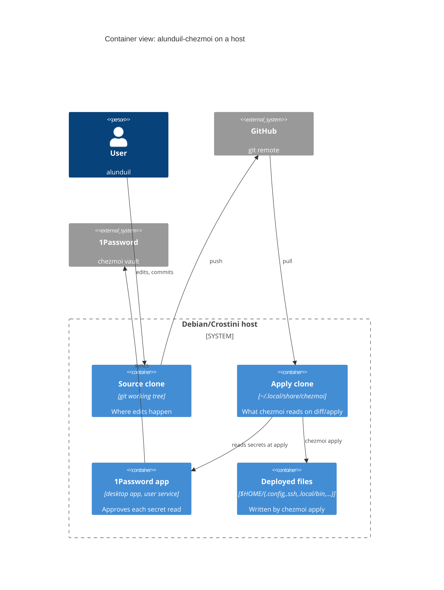

# Architecture

How a change travels from an edit in this repo to a configured host, and
why each stage has the shape it does. For setup, see
[tutorials/bootstrap.md](../tutorials/bootstrap.md). For the rules each
stage follows, see
[reference/bootstrap-reference.md](../reference/bootstrap-reference.md).

## Two clones

An edit doesn't reach the host until it's committed, pushed, and pulled
into the apply clone, because `chezmoi apply` reads only the apply
clone. The detour costs a commit and a pull, and keeps a half-finished
edit from reaching a live apply.

## Apply converges the host

`chezmoi apply` does two jobs: it writes files into `$HOME`, and it runs
bootstrap passes that install and configure what those files expect.
Both converge on a target state: apply offers to restore a file that
drifted, and a pass installs a removed tool again.

Passes run on every apply so they can see drift. [chezmoi's
package-install
guide](https://www.chezmoi.io/user-guide/advanced/install-packages-declaratively/)
recommends `run_onchange_`, but a trigger keyed on script content never
fires when only the host changed.

Convergence makes apply the one operation for both a fresh host and a
drifted one. Bootstrap is the first apply, and every later apply
repairs whatever changed since. Pinned tools follow the same rule: a
pass runs `mise install` on every apply, so a deleted or bumped tool,
mise included, comes back at the version and checksum in `mise.lock`
([ADR 0009](../adr/0009-install-pinned-tools-through-mise.md)).
Host mise skips a checkout's `mise.toml`. That file applies only in the
checkout's devcontainer or CI
([ADR 0011](../adr/0011-restrict-host-mise-to-its-global-config.md)).

## chezmoi owns home, Ansible owns the system

The host has two layers. The home layer is dotfiles, secrets, user
units, and user-scoped tools. The system layer is apt sources and
packages, files under `/etc`, and system units. chezmoi configures the
home layer. One bootstrap pass runs a local Ansible playbook from
`ansible/`, which configures the system layer. No other pass calls
`sudo`.

chezmoi's
[design FAQ](https://www.chezmoi.io/user-guide/frequently-asked-questions/design/#can-i-use-chezmoi-to-manage-files-outside-my-home-directory)
says it "is explicitly not a full system configuration management
tool." Ansible's modules describe state: a module compares the host
with the playbook, shows the diff, and changes only what differs. A hand edit to a file the playbook owns
comes back on the next apply, and the edited copy stays beside it as a
backup. Handlers restart a service only when its config changed.
[ADR 0010](../adr/0010-configure-the-system-layer-with-ansible.md)
records the options weighed.

The playbook runs before chezmoi writes any file, so the packages that
dotfiles and user units expect are already installed. Files no role
owns stay literal under `etc/`, at the path they take under `/etc`.

Convergence holds only for what the playbook names. A package or file
dropped from it stays on the host until a task removes it.

## Secrets live in the vault

Apart from one age-encrypted Cloudflare token, the repo holds no
secrets. It names items in the `chezmoi` 1Password vault, and apply
reads them through the 1Password desktop app on the way into `$HOME`.
The repo is public, so a rotation leaves nothing behind in its history.

Rotation is an edit in the vault followed by an apply. Scripts that
hand a secret to a long-running consumer, such as Alloy, key on a hash
of its value. The apply after a rotation reruns them.

The desktop app is the trust boundary on the host. It approves each
process that reads a secret, so a new process gets a new prompt even
while the app stays unlocked. The SSH key is the exception: approval
per application would prompt in every shell and Claude session. Instead,
`ssh-load` reads it into an OpenSSH agent for eight hours, and an expired
key raises one dialog on its next use from a terminal. Uses without a
terminal, such as status bars and timers, fail until then, since nobody
is there to answer the dialog. The key never reaches disk, but
while loaded any process running as the user can use it.
On Crostini nothing else would keep the app alive, so a user service
runs it without a window.

A locked 1Password makes apply fail rather than write an empty
secret. The one way to skip secrets is to set `CHEZMOI_NO_1PASSWORD`,
which the checks and the first bootstrap pass do on purpose. An opt-out
nobody sets by accident is safer than a default that degrades without
notice.

Recovery rests on the 1Password Emergency Kit
([`how-to/recover-access.md`](../how-to/recover-access.md)).

## Beyond this host

Every stage here happens on a host that runs `chezmoi apply`. A Claude
Code session on the web or in a cloud routine starts from a fresh clone
of one repo and receives none of it.
[ADR 0005](../adr/0005-treat-the-checkout-as-the-only-portable-context.md)
records what such a session loads and why the split stays.
