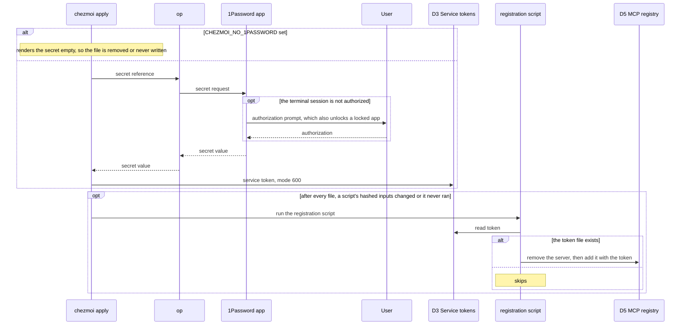
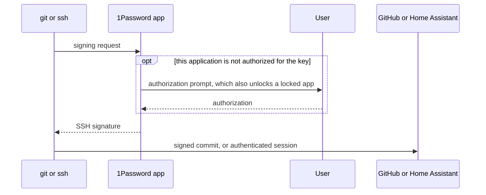

# Paths

The order of three paths across the [data flow](data-flow.md#level-0),
and the branches each can take. In the sequence diagrams, an `alt`
box runs exactly one of its bracketed branches, and an `opt` box runs
only when its condition holds.

## Read a secret at apply

Process `1.0`, through `2.0`, for every reference in
`.chezmoidata/onepassword.yaml`.

An authorization covers the terminal session and its sub-shells. It
lapses after 10 minutes of inactivity in that session, and after 12
hours regardless.

The TrueNAS script also hashes the appliance's address.

## Call a tool

Process `3.0`, for every tool call the model proposes.

```mermaid
sequenceDiagram
  participant Model as Claude API
  participant Session as Claude Code
  participant Pre as PreToolUse hooks
  participant User
  participant Tool as MCP server, shell, or file edit
  participant Post as PostToolUse hooks
  participant Tree as D10 Working tree

  Model-->>Session: tool call
  Session->>Pre: proposed tool call
  alt a pull request without draft: true, or input the guard can't parse
    Pre-->>Session: rejection
    Session->>Model: rejection as the tool error
  else
    opt the permission rules ask
      Session->>User: permission prompt
      User-->>Session: decision
    end
    Session->>Tool: allowed tool call
    alt the tool succeeds
      Tool-->>Session: tool result
      Session->>Post: tool result
      opt an edited file in a repository with a pre-commit configuration
        Post->>Tree: run pre-commit on the file, applying its fixes
        opt pre-commit fails
          Post-->>Session: lint findings
        end
      end
      Session->>Model: tool result and any lint findings
    else the tool fails
      Tool-->>Session: error
      Session->>Model: error
    end
  end
```

The draft guard covers `create_pull_request` and its Copilot variant. A
failed tool runs the `PostToolUseFailure` hooks in place of
`PostToolUse`. Hooks in every phase also send session events to the
zellaude plugin under `9.0`, asynchronously.

## Sign a commit or authenticate a connection

Process `4.0`, through `2.0`. `git` signs through `op-ssh-sign`. `ssh`
authenticates through the agent socket.

An authorization covers the application and its child processes, for
that key, until 1Password locks or quits. The private key never leaves
D4. The app keeps an unencrypted copy of the public key on disk.
