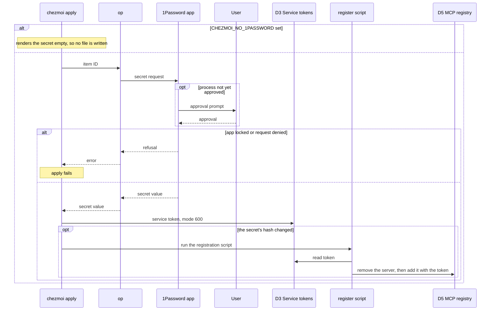
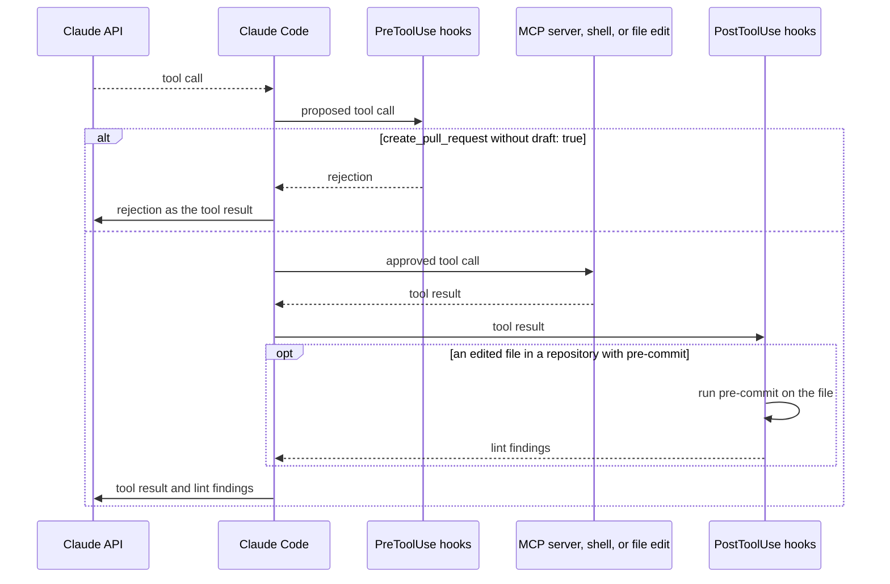
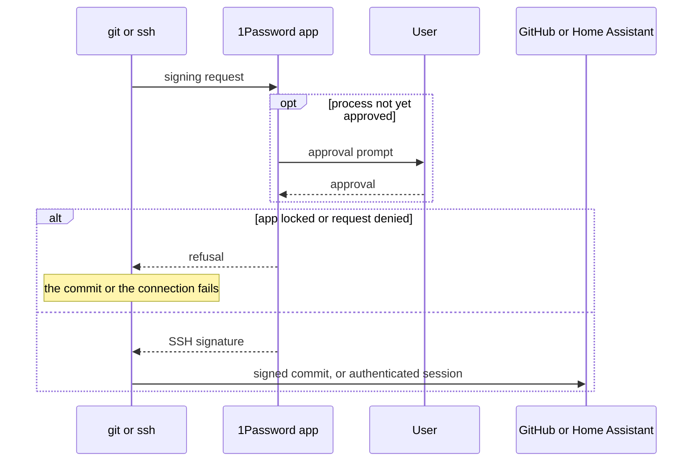

# Paths

The order of three paths across the [data flow](data-flow.md#level-0),
and what a failure does at each step. In the sequence diagrams, an `alt`
box runs exactly one of its bracketed branches, and an `opt` box runs
only when its condition holds.

## Read a secret at apply

Process `1.0`, through `2.0`, for every item in
`.chezmoidata/onepassword.yaml`.

A changed Grafana Cloud token restarts `alloy.service` in place of a
registration.

## Call a tool

Process `3.0`, for every tool call the model proposes.

Both hook phases also send session events to the Zellij pane title,
asynchronously.

## Sign a commit or authenticate a connection

Process `4.0`, through `2.0`. `git` signs through `op-ssh-sign`. `ssh`
authenticates through the agent socket.

The SSH key never leaves D4. Only the signature crosses to `4.0`.
