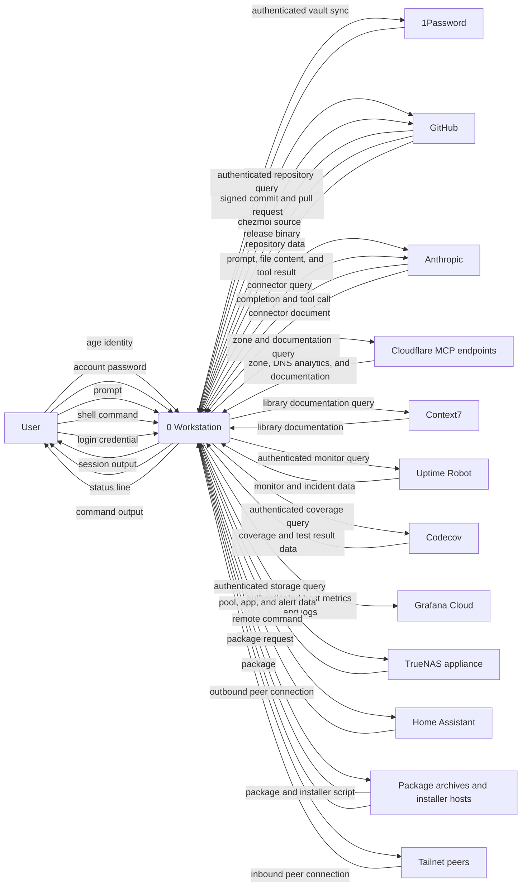
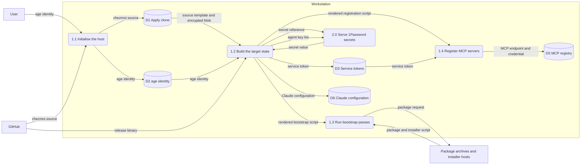
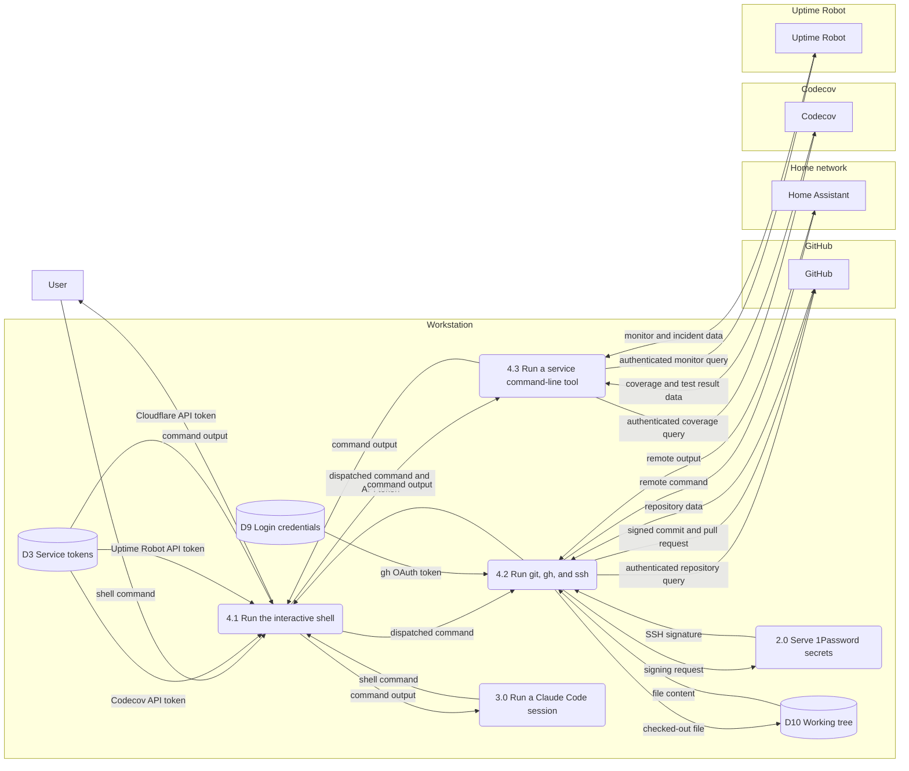

# Data flow

Where each credential on a `workstation` host lives, which processes move
it, and which trust boundary each flow crosses. Elements name the real
software: the Model Context Protocol (MCP) servers a Claude Code session
calls, the systemd units, the 1Password desktop app. Out of scope:

- Cloud and home-network internals. GitHub, Cloudflare, and the home
  network stay external entities here. `alunduil-infrastructure` carries
  their data flow diagram.
- The `ha-terminal` role, which deploys only the Claude Code
  configuration and a `.vimrc`.
- Flows from command-line tools the user drives by hand on their own
  login: `gcx`, `readwise`, `keybase`, and `signal-cli`. Their credentials
  appear under [Credentials](#credentials).
- What crosses a tailnet tunnel.
- Installed software as a store. The diagrams show only where it comes
  from.

Process numbers follow the level: `1.0` at Level 0, `1.1` beneath it.
Data stores carry numbers D1 to D10, the same at every level.

---

## Context

Thirteen external entities exchange data with the workstation.

---

## Level 0

The workstation runs eight processes over ten data stores. Every flow to
an external entity crosses one of these trust boundaries:

- The workstation, a Crostini VM. Its processes share one user account,
  so a bootstrap pass and a model-driven session reach the same stores.
- The 1Password desktop app, inside the workstation. It holds the vault
  cache and the SSH key, and prompts the user before releasing a secret
  to the `op` command-line tool.
- 1Password, Anthropic, GitHub, and Cloudflare, one boundary each.
- Context7, Uptime Robot, Codecov, and Grafana Cloud, each a separate
  third-party service.
- The home network: the TrueNAS appliance and Home Assistant.
- Package archives and installer hosts: six vendor apt repositories and
  the Tailscale and nvm install scripts.
- Peers on the tailnet, the only path into the host that the host didn't open.

```mermaid
flowchart TB
  user[User]

  subgraph ws[Workstation: Crostini VM, one user account]
    apply(1.0 Apply the chezmoi source)
    session(3.0 Run a Claude Code session)
    tooling(4.0 Run developer tooling)
    ship(5.0 Ship host telemetry)
    login(6.0 Authenticate interactively)
    maintain(7.0 Run scheduled maintenance)
    serveTailnet(8.0 Serve the tailnet)

    clone[(D1 Apply clone)]
    ageKey[(D2 age identity)]
    tokens[(D3 Service tokens)]
    registry[(D5 MCP registry)]
    claudeConfig[(D6 Claude configuration)]
    record[(D7 Session record)]
    hostTelemetry[(D8 Host telemetry)]
    logins[(D9 Login credentials)]
    worktree[(D10 Working tree)]

    subgraph opapp[1Password desktop app: unlocked by the user]
      broker(2.0 Serve 1Password secrets)
      vault[(D4 Vault cache)]
    end
  end

  subgraph op[1Password]
    onepassword[1Password]
  end

  subgraph gh[GitHub]
    github[GitHub]
  end

  subgraph anth[Anthropic]
    anthropic[Anthropic]
  end

  subgraph cf[Cloudflare]
    cloudflare[Cloudflare MCP endpoints]
  end

  subgraph c7[Context7]
    context7[Context7]
  end

  subgraph ur[Uptime Robot]
    uptimerobot[Uptime Robot]
  end

  subgraph cc[Codecov]
    codecov[Codecov]
  end

  subgraph gc[Grafana Cloud]
    grafana[Grafana Cloud]
  end

  subgraph home[Home network]
    truenas[TrueNAS appliance]
    homeassistant[Home Assistant]
  end

  subgraph dist[Package archives and installer hosts]
    upstream[Package archives and installer hosts]
  end

  subgraph tn[Tailnet]
    tailnet[Tailnet peers]
  end

  user -->|age identity| apply
  github -->|chezmoi source| apply
  github -->|release binary| apply
  apply -->|chezmoi source| clone
  clone -->|source template and encrypted blob| apply
  apply -->|age identity| ageKey
  ageKey -->|age identity| apply
  apply -->|secret reference| broker
  apply -->|agent key list| broker
  broker -->|secret value| apply
  apply -->|service token| tokens
  tokens -->|service token| apply
  apply -->|MCP endpoint and credential| registry
  apply -->|Claude configuration| claudeConfig
  apply -->|package request| upstream
  upstream -->|package and installer script| apply

  user -->|account password| broker
  onepassword -->|vault item| broker
  broker -->|authenticated vault sync| onepassword
  broker -->|vault item| vault
  vault -->|vault item| broker
  tooling -->|signing request| broker
  broker -->|SSH signature| tooling

  user -->|prompt| session
  session -->|session output| user
  session -->|status line| user
  registry -->|MCP endpoint and credential| session
  claudeConfig -->|Claude configuration| session
  record -->|transcript and memory| session
  session -->|transcript and memory| record
  logins -->|Anthropic session credential| session
  worktree -->|file content| session
  session -->|edited file| worktree
  session -->|shell command| tooling
  tooling -->|command output| session
  session -->|zellij log and process metric| hostTelemetry
  anthropic -->|completion and tool call| session
  anthropic -->|connector document| session
  session -->|prompt, file content, and tool result| anthropic
  session -->|connector query| anthropic
  github -->|repository data| session
  session -->|authenticated repository query| github
  cloudflare -->|zone, DNS analytics, and documentation| session
  session -->|zone and documentation query| cloudflare
  context7 -->|library documentation| session
  session -->|library documentation query| context7
  uptimerobot -->|monitor and incident data| session
  session -->|authenticated monitor query| uptimerobot
  truenas -->|pool, app, and alert data| session
  session -->|authenticated storage query| truenas

  user -->|shell command| tooling
  tooling -->|command output| user
  tokens -->|Codecov API token| tooling
  tokens -->|Uptime Robot API token| tooling
  tokens -->|Cloudflare API token| tooling
  logins -->|gh OAuth token| tooling
  worktree -->|file content| tooling
  tooling -->|checked-out file| worktree
  github -->|repository data| tooling
  tooling -->|authenticated repository query| github
  tooling -->|signed commit and pull request| github
  codecov -->|coverage and test result data| tooling
  tooling -->|authenticated coverage query| codecov
  uptimerobot -->|monitor and incident data| tooling
  tooling -->|authenticated monitor query| uptimerobot
  homeassistant -->|remote output| tooling
  tooling -->|remote command| homeassistant

  tokens -->|Grafana Cloud token| ship
  hostTelemetry -->|journal entry, zellij log, and process metric| ship
  ship -->|authenticated host metrics and logs| grafana

  user -->|login credential| login
  login -->|login credential| logins

  logins -->|gh OAuth token| maintain
  worktree -->|file content| maintain
  github -->|repository data| maintain
  maintain -->|authenticated repository query| github
  maintain -->|pruned branch| worktree
  upstream -->|package| maintain
  maintain -->|package request| upstream
  maintain -->|process metric| hostTelemetry

  logins -->|node key| serveTailnet
  tailnet -->|inbound peer connection| serveTailnet
  serveTailnet -->|outbound peer connection| tailnet
```

| Store | Holds | At rest |
| --- | --- | --- |
| D1 Apply clone | The chezmoi source at `~/.local/share/chezmoi`, cloned from GitHub | Plaintext, apart from the age-encrypted Cloudflare token |
| D2 age identity | The key that decrypts the Cloudflare token | Unencrypted, mode 600 |
| D3 Service tokens | Five tokens from 1Password and the Cloudflare token | Unencrypted, mode 600 |
| D4 Vault cache | The 1Password vault, including the SSH key | Encrypted by 1Password |
| D5 MCP registry | Claude Code's user-scope MCP configuration, which Claude Code rewrites | Unencrypted, with the GitHub and Uptime Robot bearer tokens and the TrueNAS API key |
| D6 Claude configuration | Settings, hooks, skills, and the status line under `~/.claude/` | Plaintext |
| D7 Session record | Transcripts and per-project memory | Plaintext, local to the host |
| D8 Host telemetry | The journal, the Zellij server log, and process metrics | Plaintext |
| D9 Login credentials | What each interactive login writes | Per tool |
| D10 Working tree | Every repository checked out under `$HOME` | Plaintext |

Three control signals carry no data:

- A rotated secret re-registers its MCP server, or restarts
  `alloy.service` to load the new Grafana Cloud token.
- systemd timers start every process under `7.0`.
- The 1Password app's approval prompt gates each `secret reference`
  before `secret value` flows back.

---

## Apply the chezmoi source

Process `1.0` turns the out-of-band secrets, the age identity and the
1Password unlock, into every deployed token.

`1.2` reads the apply clone, never a developer's working tree, so
`chezmoi source` always originates at GitHub.
[Architecture](../explanation/architecture.md) covers why the two clones
are separate.

`1.2` resolves each `secret reference`, an item ID from
`.chezmoidata/onepassword.yaml`, through `op` and the desktop app. Until
the user signs in to the app, every 1Password secret deploys empty.

`1.2` also fetches the chezmoi externals: pinned release assets from
GitHub, with no checksum on the asset. `1.3` adds six vendor apt
repositories with their signing keys and pipes the Tailscale and nvm
install scripts into a shell.

`1.4` copies the GitHub and Uptime Robot tokens and the TrueNAS API key
from D3 into D5.

---

## Run a Claude Code session

Process `3.0` calls every MCP server, each across its own trust
boundary.

```mermaid
flowchart TB
  user[User]

  subgraph ws[Workstation]
    turns(3.1 Exchange turns with the model)
    gate(3.2 Gate the tool call)
    annotate(3.3 Annotate the tool result)
    callMcp(3.4 Call an MCP server)
    statusLine(3.5 Render the status line)
    edit(3.6 Edit a working tree file)
    tooling(4.0 Run developer tooling)

    registry[(D5 MCP registry)]
    claudeConfig[(D6 Claude configuration)]
    record[(D7 Session record)]
    hostTelemetry[(D8 Host telemetry)]
    logins[(D9 Login credentials)]
    worktree[(D10 Working tree)]
  end

  subgraph anth[Anthropic]
    anthropic[Claude API and claude.ai connectors]
  end

  subgraph gh[GitHub]
    github[GitHub Copilot MCP]
  end

  subgraph cf[Cloudflare]
    cloudflare[Cloudflare MCP endpoints]
  end

  subgraph c7[Context7]
    context7[Context7]
  end

  subgraph ur[Uptime Robot]
    uptimerobot[Uptime Robot]
  end

  subgraph home[Home network]
    truenas[TrueNAS appliance]
  end

  user -->|prompt| turns
  claudeConfig -->|Claude configuration| turns
  record -->|transcript and memory| turns
  logins -->|Anthropic session credential| turns
  turns -->|transcript and memory| record
  turns -->|session output| user
  turns -->|zellij log and process metric| hostTelemetry
  turns -->|session usage| statusLine
  statusLine -->|status line| user

  anthropic -->|completion and tool call| turns
  turns -->|prompt, file content, and tool result| anthropic

  turns -->|proposed tool call| gate
  gate -->|shell command| tooling
  gate -->|approved tool call| callMcp
  gate -->|approved file edit| edit
  callMcp -->|tool result| annotate

  worktree -->|file content| edit
  edit -->|edited file| worktree
  edit -->|tool result| annotate

  tooling -->|command output| annotate
  annotate -->|annotated tool result| turns

  registry -->|MCP endpoint and credential| callMcp
  callMcp -->|connector query| anthropic
  anthropic -->|connector document| callMcp
  callMcp -->|authenticated repository query| github
  github -->|repository data| callMcp
  callMcp -->|zone and documentation query| cloudflare
  cloudflare -->|zone, DNS analytics, and documentation| callMcp
  callMcp -->|library documentation query| context7
  context7 -->|library documentation| callMcp
  callMcp -->|authenticated monitor query| uptimerobot
  uptimerobot -->|monitor and incident data| callMcp
  callMcp -->|authenticated storage query| truenas
  truenas -->|pool, app, and alert data| callMcp
```

`3.2` is the `PreToolUse` hook phase, layered over Claude Code's
permission prompts. The draft guard there rejects a
`create_pull_request` call without `draft: true`. `3.3` is the
`PostToolUse` phase: it runs pre-commit on a just-written file and emits
the session events the Zellij pane title reads.

Each MCP server authenticates `3.4` with its own credential:

| Server | Credential | Held in |
| --- | --- | --- |
| Notion and Readwise, through claude.ai connectors | OAuth grant on the Anthropic account | Anthropic |
| Cloudflare `graphql`, `docs`, `dns-analytics` | OAuth grant from a browser sign-in | Claude Code, outside the chezmoi source |
| GitHub, Uptime Robot | Bearer token | D5 |
| TrueNAS | API key as an environment variable | D5 |
| Context7 | None | Not applicable |

TrueNAS runs with certificate verification off: the appliance's
certificate carries no IP subject alternative name.

---

## Run developer tooling

Process `4.0` is the shell both the user and the session run commands
in, and the one place a credential lives in an environment variable.

`4.1` is `dot_bashrc` exporting three tokens from D3, which every child
process inherits. `4.3` is `codecov-api` and the `uptimerobot` command-line
tool, each reading its token from the environment.

`4.2` signs commits and authenticates SSH through the 1Password agent.
The SSH key stays in D4: `signing request` carries the data to sign, and
`SSH signature` carries back only the signature. `agent.toml` limits the
agent to the keys `1.2` lists.

The Cloudflare API token enters `4.1` and leaves through no drawn flow.
Nothing this repository manages reads it.

---

## Credentials

Every credential on the host, by where it comes from.

| Credential | Source | Held in | Read by | Reaches |
| --- | --- | --- | --- | --- |
| 1Password account password and Secret Key | The user | Not stored | `2.0` | 1Password |
| age identity | The user, at bootstrap | D2 | `1.2` | none |
| SSH key | 1Password | D4 | `2.0`, for `4.2` | GitHub, Home Assistant |
| GitHub token | 1Password | D3, D5 | `1.4`, `3.4` | GitHub |
| TrueNAS API key | 1Password | D3, D5 | `1.4`, `3.4` | Home network |
| Uptime Robot token | 1Password | D3, D5 | `1.4`, `3.4`, `4.3` | Uptime Robot |
| Codecov token | 1Password | D3 | `4.3` | Codecov |
| Grafana Cloud token | 1Password | D3 | `5.0` | Grafana Cloud |
| Cloudflare token | age-encrypted in D1 | D3 | `4.1` | none drawn |
| Claude Code session | `claude` login | D9 | `3.1` | Anthropic |
| `gh` OAuth token | `gh auth login` | D9 | `4.2`, `7.0` | GitHub |
| Tailscale node key | `tailscale up` | D9 | `8.0` | Peers on the tailnet |
| Grafana Cloud login | `gcx login` | D9 | `gcx` | Grafana Cloud |
| Readwise token | `readwise login` | D9 | `readwise` | Readwise |
| Keybase device keys | `keybase login` | D9 | `keybase` | Keybase |
| Signal registration | `signal-cli register`, Signal Desktop link | D9 | `signal-cli`, Signal Desktop | Signal |

Nothing re-establishes the D9 credentials on apply. A new host repeats
each login by hand. `7.0` spends the `gh` OAuth token with no person
present.
