# Data flow

Which processes move data on a `workstation` host, which stores they
read and write, and which trust boundary each flow crosses. That
includes every Model Context Protocol (MCP) server a Claude Code
session calls. Out of scope:

- Cloud and home-network internals. GitHub, Cloudflare, and the home
  network stay external entities here.
- The `ha-terminal` role, which deploys only the Claude Code
  configuration and a `.vimrc`.
- Flows from command-line tools the user drives by hand on their own
  login: `gcx`, `readwise`, `keybase`, and `signal-cli`.
- The Signal Desktop and Keybase background services.
- claude.ai connectors beyond the Notion and Readwise ones the settings
  allow.
- Package registries reached during development work: npm, crates.io,
  PyPI, and Docker registries.
- `gcx agent skills install` during apply.
- Apply reading the live Claude Code settings it merges into.
- Unattended cleanup: `dev-cache-gc`, `docker-prune`, and
  `systemd-tmpfiles-clean`.
- The sysstat activity record and Alloy's local HTTP port.
- What crosses a tailnet tunnel.
- Installed software as a store. The diagrams show only where it comes
  from.

Each credential's source, holder, and reach is in
[Credentials](data-flow-credentials.md). The order of a secret read, a
tool call, and a signature, and what a failure does to each, is in
[Paths](data-flow-paths.md). [Architecture](../explanation/architecture.md)
explains why the host has this shape.

---

## Context

Sixteen external entities exchange data with the workstation.

```mermaid
flowchart LR
  user[User]
  onepassword[1Password]
  github[GitHub]
  anthropic[Anthropic]
  telemetry[Telemetry services]
  cloudflare[Cloudflare MCP endpoints]
  context7[Context7]
  uptimerobot[Uptime Robot]
  codecov[Codecov]
  grafana[Grafana Cloud]
  truenas[TrueNAS appliance]
  homeassistant[Home Assistant]
  upstream[Package archives and installer hosts]
  web[Web hosts]
  coordination[Tailscale coordination server]
  tailnet[Tailnet peers]

  system(0 Workstation)

  user -->|age identity| system
  user -->|login command| system
  user -->|account password| system
  user -->|prompt| system
  user -->|shell command| system
  system -->|session output| user
  system -->|status line| user
  system -->|status bar| user
  system -->|command output| user

  onepassword -->|vault item| system
  system -->|authenticated vault sync| onepassword

  github -->|chezmoi source| system
  github -->|release binary and installer script| system
  github -->|Zellij plugin| system
  github -->|repository data| system
  github -->|OAuth token| system
  github -->|health status| system
  system -->|authenticated repository query| github
  system -->|authenticated repository write| github
  system -->|signed commit and pull request| github
  system -->|authorization request| github
  system -->|MCP health check| github

  anthropic -->|completion and tool call| system
  anthropic -->|connector document| system
  anthropic -->|session credential| system
  system -->|prompt, file content, and tool result| anthropic
  system -->|connector query| anthropic
  system -->|usage metrics| anthropic
  system -->|WebFetch hostname| anthropic
  system -->|authorization request| anthropic
  system -->|usage metrics and error reports| telemetry

  cloudflare -->|DNS and GraphQL analytics| system
  cloudflare -->|documentation| system
  cloudflare -->|OAuth grant| system
  cloudflare -->|health status| system
  system -->|authenticated analytics query| cloudflare
  system -->|documentation query| cloudflare
  system -->|authorization request| cloudflare
  system -->|MCP health check| cloudflare
  context7 -->|library documentation| system
  context7 -->|health status| system
  system -->|library documentation query| context7
  system -->|MCP health check| context7
  uptimerobot -->|monitor and incident data| system
  uptimerobot -->|health status| system
  system -->|authenticated monitor query| uptimerobot
  system -->|MCP health check| uptimerobot
  codecov -->|coverage and test result data| system
  system -->|authenticated coverage query| codecov
  system -->|authenticated host metrics and logs| grafana

  truenas -->|pool, app, and alert data| system
  system -->|authenticated storage query| truenas
  homeassistant -->|remote output| system
  system -->|remote command| homeassistant

  upstream -->|package and installer script| system
  upstream -->|package| system
  upstream -->|Claude Code release| system
  system -->|package request| upstream
  system -->|update check| upstream

  web -->|web page| system
  system -->|web request| web

  coordination -->|peer public keys and addresses| system
  system -->|node public key and address| coordination
  tailnet -->|inbound peer connection| system
  system -->|outbound peer connection| tailnet
```

---

## Level 0

The workstation runs ten processes over eleven data stores, across these
trust boundaries:

- The workstation, a Crostini Linux container. Processes `1.0` to `7.0`
  and `9.0` run as one user, so a bootstrap pass and a model-driven
  session reach the same stores. Bootstrap passes and `tailscale up`
  under `6.0` also run commands as root through `sudo`.
- Root services inside the workstation: `8.0`, `10.0`, and D11.
- The 1Password desktop app, inside the workstation. It holds the vault
  cache and the SSH key, and releases a secret or a signature only after
  the user authorizes the requester.
- 1Password, Anthropic, GitHub, and Cloudflare, one boundary each.
- Context7, Uptime Robot, Codecov, and Grafana Cloud, each a separate
  third-party service.
- The third-party logging and error-tracking services that receive
  Claude Code telemetry.
- The home network: the TrueNAS appliance and Home Assistant.
- Package archives and installer hosts:
  - Seven apt repositories the bootstrap adds, one of them Keybase's
    unsigned repository, plus the Microsoft and Tailscale repositories
    their own installers add.
  - The npm registry and crates.io.
  - The Tailscale, ghcup, and rustup install scripts, piped into a
    shell, the toolchains they fetch, and the VS Code package.
- Web hosts a session fetches with WebFetch.
- The Tailscale coordination server.
- Peers on the tailnet, the only path into the host that the host
  didn't open.

```mermaid
flowchart TB
  user[User]

  subgraph ws[Workstation: user account]
    apply(1.0 Apply the chezmoi source)
    session(3.0 Run a Claude Code session)
    tooling(4.0 Run developer tooling)
    ship(5.0 Ship host telemetry)
    setup(6.0 Set up credentials by hand)
    maintain(7.0 Run scheduled maintenance)
    statusBar(9.0 Run Zellij and its status bar)

    clone[(D1 Apply clone)]
    ageKey[(D2 age identity)]
    tokens[(D3 Service tokens)]
    registry[(D5 MCP registry)]
    claudeConfig[(D6 Claude configuration)]
    record[(D7 Session record)]
    hostTelemetry[(D8 Host telemetry)]
    logins[(D9 Login credentials)]
    worktree[(D10 Working tree)]

    subgraph opapp[1Password desktop app: authorized by the user]
      broker(2.0 Serve 1Password secrets)
      vault[(D4 Vault cache)]
    end

    subgraph rootside[Workstation: root]
      serveTailnet(8.0 Serve the tailnet)
      upgrade(10.0 Install security updates)
      nodeState[(D11 Tailscale state)]
    end
  end

  subgraph op[1Password]
    onepassword[1Password]
  end

  subgraph gh[GitHub]
    github[GitHub]
  end

  subgraph anth[Anthropic]
    anthropic[Anthropic]
  end

  subgraph tel[Telemetry services]
    telemetry[Telemetry services]
  end

  subgraph cf[Cloudflare]
    cloudflare[Cloudflare MCP endpoints]
  end

  subgraph c7[Context7]
    context7[Context7]
  end

  subgraph ur[Uptime Robot]
    uptimerobot[Uptime Robot]
  end

  subgraph cc[Codecov]
    codecov[Codecov]
  end

  subgraph gc[Grafana Cloud]
    grafana[Grafana Cloud]
  end

  subgraph home[Home network]
    truenas[TrueNAS appliance]
    homeassistant[Home Assistant]
  end

  subgraph dist[Package archives and installer hosts]
    upstream[Package archives and installer hosts]
  end

  subgraph webHosts[Web hosts]
    web[Web hosts]
  end

  subgraph ts[Tailscale]
    coordination[Tailscale coordination server]
  end

  subgraph tn[Tailnet]
    tailnet[Tailnet peers]
  end

  github -->|chezmoi source| apply
  github -->|release binary and installer script| apply
  apply -->|chezmoi source| clone
  clone -->|source template and encrypted blob| apply
  ageKey -->|age identity| apply
  apply -->|secret reference| broker
  apply -->|agent key list| broker
  broker -->|secret value| apply
  apply -->|service token| tokens
  tokens -->|service token| apply
  apply -->|MCP endpoint and credential| registry
  registry -->|MCP endpoint and credential| apply
  apply -->|Claude configuration| claudeConfig
  apply -->|package request| upstream
  upstream -->|package and installer script| apply
  apply -->|MCP health check| github
  github -->|health status| apply
  apply -->|MCP health check| cloudflare
  cloudflare -->|health status| apply
  apply -->|MCP health check| context7
  context7 -->|health status| apply
  apply -->|MCP health check| uptimerobot
  uptimerobot -->|health status| apply

  user -->|account password| broker
  onepassword -->|vault item| broker
  broker -->|authenticated vault sync| onepassword
  broker -->|vault item| vault
  vault -->|vault item| broker
  tooling -->|signing request| broker
  broker -->|SSH signature| tooling

  user -->|prompt| session
  session -->|session output| user
  session -->|status line| user
  registry -->|MCP endpoint and credential| session
  claudeConfig -->|Claude configuration| session
  record -->|transcript and memory| session
  session -->|transcript and memory| record
  logins -->|Anthropic session credential| session
  logins -->|MCP OAuth grant| session
  session -->|MCP OAuth grant| logins
  worktree -->|file content| session
  session -->|edited file| worktree
  session -->|shell command| tooling
  tooling -->|command output| session
  session -->|session event| statusBar
  anthropic -->|completion and tool call| session
  anthropic -->|connector document| session
  session -->|prompt, file content, and tool result| anthropic
  session -->|connector query| anthropic
  session -->|usage metrics| anthropic
  session -->|WebFetch hostname| anthropic
  session -->|usage metrics and error reports| telemetry
  session -->|web request| web
  web -->|web page| session
  session -->|update check| upstream
  upstream -->|Claude Code release| session
  github -->|repository data| session
  session -->|authenticated repository query| github
  session -->|authenticated repository write| github
  session -->|authorization request| cloudflare
  cloudflare -->|OAuth grant| session
  cloudflare -->|DNS and GraphQL analytics| session
  cloudflare -->|documentation| session
  session -->|authenticated analytics query| cloudflare
  session -->|documentation query| cloudflare
  context7 -->|library documentation| session
  session -->|library documentation query| context7
  uptimerobot -->|monitor and incident data| session
  session -->|authenticated monitor query| uptimerobot
  truenas -->|pool, app, and alert data| session
  session -->|authenticated storage query| truenas

  user -->|shell command| tooling
  tooling -->|command output| user
  tokens -->|Codecov API token| tooling
  tokens -->|Uptime Robot API token| tooling
  tokens -->|Cloudflare API token| tooling
  logins -->|gh OAuth token| tooling
  worktree -->|file content| tooling
  tooling -->|checked-out file| worktree
  github -->|repository data| tooling
  tooling -->|authenticated repository query| github
  tooling -->|signed commit and pull request| github
  codecov -->|coverage and test result data| tooling
  tooling -->|authenticated coverage query| codecov
  uptimerobot -->|monitor and incident data| tooling
  tooling -->|authenticated monitor query| uptimerobot
  homeassistant -->|remote output| tooling
  tooling -->|remote command| homeassistant

  tokens -->|Grafana Cloud token| ship
  hostTelemetry -->|journal entry, zellij log, and process metric| ship
  ship -->|authenticated host metrics and logs| grafana

  user -->|age identity| setup
  user -->|login command| setup
  setup -->|age identity| ageKey
  setup -->|authorization request| github
  github -->|OAuth token| setup
  setup -->|authorization request| anthropic
  anthropic -->|session credential| setup
  setup -->|login credential| logins
  setup -->|tailnet login request| serveTailnet

  logins -->|gh OAuth token| maintain
  worktree -->|file content| maintain
  github -->|repository data| maintain
  maintain -->|authenticated repository query| github
  maintain -->|pruned branch| worktree
  maintain -->|process metric| hostTelemetry

  serveTailnet -->|node key| nodeState
  nodeState -->|node key| serveTailnet
  serveTailnet -->|node public key and address| coordination
  coordination -->|peer public keys and addresses| serveTailnet
  tailnet -->|inbound peer connection| serveTailnet
  serveTailnet -->|outbound peer connection| tailnet

  github -->|Zellij plugin| statusBar
  logins -->|gh OAuth token| statusBar
  worktree -->|file content| statusBar
  github -->|repository data| statusBar
  statusBar -->|authenticated repository query| github
  statusBar -->|status bar| user
  statusBar -->|zellij log| hostTelemetry

  upstream -->|package| upgrade
  upgrade -->|package request| upstream
```

| Store | Holds | At rest |
| --- | --- | --- |
| D1 Apply clone | The chezmoi source at `~/.local/share/chezmoi`, cloned from GitHub | Plaintext, apart from the age-encrypted Cloudflare token |
| D2 age identity | The key that decrypts the Cloudflare token, placed by hand at bootstrap | Unencrypted, mode 600 |
| D3 Service tokens | Five tokens from 1Password and the Cloudflare token | Unencrypted, mode 600 |
| D4 Vault cache | The 1Password vault, including the SSH key | Managed by 1Password, mode 600 |
| D5 MCP registry | Claude Code's user-scope MCP configuration | Unencrypted, with the GitHub and Uptime Robot bearer tokens and the TrueNAS API key |
| D6 Claude configuration | Settings, hooks, skills, the status line, and the user-level instruction files under `~/.claude/` | Plaintext |
| D7 Session record | Transcripts and per-project memory | Plaintext, local to the host |
| D8 Host telemetry | The journal, the Zellij server log, the Zellij diagnostic directory Alloy tails, the cgroup process-count textfile, and Alloy's write-ahead log | Unencrypted |
| D9 Login credentials | What each login writes, including the Claude Code session and its MCP OAuth grants | Per tool |
| D10 Working tree | The user's GitHub clones and their worktrees | Plaintext |
| D11 Tailscale state | The node key and preferences | Root-owned |

Four control signals carry no data:

- A change to the GitHub, Uptime Robot, or TrueNAS secret, seen on the
  next apply, re-registers that MCP server. A change to the Grafana
  Cloud token restarts `alloy.service`.
- systemd timers start every process under `7.0` and `10.0`.
- zjstatus reruns the status-bar commands under `9.0` every 30 to 60
  seconds.
- The user's authorization in the 1Password app gates each
  `secret reference` and `signing request`.
