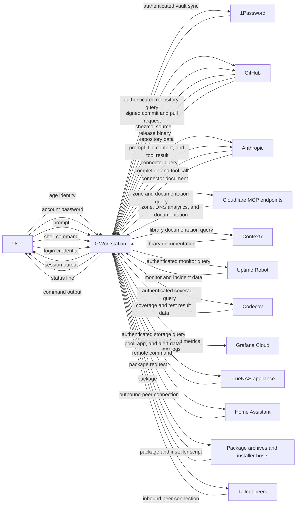

# Data flow

Which processes move data on a `workstation` host, which stores they
read and write, and which trust boundary each flow crosses. Elements name the real
software: the Model Context Protocol (MCP) servers a Claude Code session
calls, the systemd units, the 1Password desktop app. Out of scope:

- Cloud and home-network internals. GitHub, Cloudflare, and the home
  network stay external entities here. `alunduil-infrastructure` carries
  their data flow diagram.
- The `ha-terminal` role, which deploys only the Claude Code
  configuration and a `.vimrc`.
- Flows from command-line tools the user drives by hand on their own
  login: `gcx`, `readwise`, `keybase`, and `signal-cli`.
- What crosses a tailnet tunnel.
- Installed software as a store. The diagrams show only where it comes
  from.

Each credential's source, holder, and reach is in
[Credentials](data-flow-credentials.md). The order of a secret read, a
tool call, and a signature, and what a failure does to each, is in
[Paths](data-flow-paths.md). [Architecture](../explanation/architecture.md)
explains why the host has this shape.

---

## Context

Thirteen external entities exchange data with the workstation.

---

## Level 0

The workstation runs eight processes over ten data stores. Every flow to
an external entity crosses one of these trust boundaries:

- The workstation, a Crostini VM. Its processes share one user account,
  so a bootstrap pass and a model-driven session reach the same stores.
- The 1Password desktop app, inside the workstation. It holds the vault
  cache and the SSH key, and prompts the user before releasing a secret
  to the `op` command-line tool.
- 1Password, Anthropic, GitHub, and Cloudflare, one boundary each.
- Context7, Uptime Robot, Codecov, and Grafana Cloud, each a separate
  third-party service.
- The home network: the TrueNAS appliance and Home Assistant.
- Package archives and installer hosts: six vendor apt repositories and
  the Tailscale and nvm install scripts.
- Peers on the tailnet, the only path into the host that the host didn't open.

```mermaid
flowchart TB
  user[User]

  subgraph ws[Workstation: Crostini VM, one user account]
    apply(1.0 Apply the chezmoi source)
    session(3.0 Run a Claude Code session)
    tooling(4.0 Run developer tooling)
    ship(5.0 Ship host telemetry)
    login(6.0 Authenticate interactively)
    maintain(7.0 Run scheduled maintenance)
    serveTailnet(8.0 Serve the tailnet)

    clone[(D1 Apply clone)]
    ageKey[(D2 age identity)]
    tokens[(D3 Service tokens)]
    registry[(D5 MCP registry)]
    claudeConfig[(D6 Claude configuration)]
    record[(D7 Session record)]
    hostTelemetry[(D8 Host telemetry)]
    logins[(D9 Login credentials)]
    worktree[(D10 Working tree)]

    subgraph opapp[1Password desktop app: unlocked by the user]
      broker(2.0 Serve 1Password secrets)
      vault[(D4 Vault cache)]
    end
  end

  subgraph op[1Password]
    onepassword[1Password]
  end

  subgraph gh[GitHub]
    github[GitHub]
  end

  subgraph anth[Anthropic]
    anthropic[Anthropic]
  end

  subgraph cf[Cloudflare]
    cloudflare[Cloudflare MCP endpoints]
  end

  subgraph c7[Context7]
    context7[Context7]
  end

  subgraph ur[Uptime Robot]
    uptimerobot[Uptime Robot]
  end

  subgraph cc[Codecov]
    codecov[Codecov]
  end

  subgraph gc[Grafana Cloud]
    grafana[Grafana Cloud]
  end

  subgraph home[Home network]
    truenas[TrueNAS appliance]
    homeassistant[Home Assistant]
  end

  subgraph dist[Package archives and installer hosts]
    upstream[Package archives and installer hosts]
  end

  subgraph tn[Tailnet]
    tailnet[Tailnet peers]
  end

  user -->|age identity| apply
  github -->|chezmoi source| apply
  github -->|release binary| apply
  apply -->|chezmoi source| clone
  clone -->|source template and encrypted blob| apply
  apply -->|age identity| ageKey
  ageKey -->|age identity| apply
  apply -->|secret reference| broker
  apply -->|agent key list| broker
  broker -->|secret value| apply
  apply -->|service token| tokens
  tokens -->|service token| apply
  apply -->|MCP endpoint and credential| registry
  apply -->|Claude configuration| claudeConfig
  apply -->|package request| upstream
  upstream -->|package and installer script| apply

  user -->|account password| broker
  onepassword -->|vault item| broker
  broker -->|authenticated vault sync| onepassword
  broker -->|vault item| vault
  vault -->|vault item| broker
  tooling -->|signing request| broker
  broker -->|SSH signature| tooling

  user -->|prompt| session
  session -->|session output| user
  session -->|status line| user
  registry -->|MCP endpoint and credential| session
  claudeConfig -->|Claude configuration| session
  record -->|transcript and memory| session
  session -->|transcript and memory| record
  logins -->|Anthropic session credential| session
  worktree -->|file content| session
  session -->|edited file| worktree
  session -->|shell command| tooling
  tooling -->|command output| session
  session -->|zellij log and process metric| hostTelemetry
  anthropic -->|completion and tool call| session
  anthropic -->|connector document| session
  session -->|prompt, file content, and tool result| anthropic
  session -->|connector query| anthropic
  github -->|repository data| session
  session -->|authenticated repository query| github
  cloudflare -->|zone, DNS analytics, and documentation| session
  session -->|zone and documentation query| cloudflare
  context7 -->|library documentation| session
  session -->|library documentation query| context7
  uptimerobot -->|monitor and incident data| session
  session -->|authenticated monitor query| uptimerobot
  truenas -->|pool, app, and alert data| session
  session -->|authenticated storage query| truenas

  user -->|shell command| tooling
  tooling -->|command output| user
  tokens -->|Codecov API token| tooling
  tokens -->|Uptime Robot API token| tooling
  tokens -->|Cloudflare API token| tooling
  logins -->|gh OAuth token| tooling
  worktree -->|file content| tooling
  tooling -->|checked-out file| worktree
  github -->|repository data| tooling
  tooling -->|authenticated repository query| github
  tooling -->|signed commit and pull request| github
  codecov -->|coverage and test result data| tooling
  tooling -->|authenticated coverage query| codecov
  uptimerobot -->|monitor and incident data| tooling
  tooling -->|authenticated monitor query| uptimerobot
  homeassistant -->|remote output| tooling
  tooling -->|remote command| homeassistant

  tokens -->|Grafana Cloud token| ship
  hostTelemetry -->|journal entry, zellij log, and process metric| ship
  ship -->|authenticated host metrics and logs| grafana

  user -->|login credential| login
  login -->|login credential| logins

  logins -->|gh OAuth token| maintain
  worktree -->|file content| maintain
  github -->|repository data| maintain
  maintain -->|authenticated repository query| github
  maintain -->|pruned branch| worktree
  upstream -->|package| maintain
  maintain -->|package request| upstream
  maintain -->|process metric| hostTelemetry

  logins -->|node key| serveTailnet
  tailnet -->|inbound peer connection| serveTailnet
  serveTailnet -->|outbound peer connection| tailnet
```

| Store | Holds | At rest |
| --- | --- | --- |
| D1 Apply clone | The chezmoi source at `~/.local/share/chezmoi`, cloned from GitHub | Plaintext, apart from the age-encrypted Cloudflare token |
| D2 age identity | The key that decrypts the Cloudflare token | Unencrypted, mode 600 |
| D3 Service tokens | Five tokens from 1Password and the Cloudflare token | Unencrypted, mode 600 |
| D4 Vault cache | The 1Password vault, including the SSH key | Encrypted by 1Password |
| D5 MCP registry | Claude Code's user-scope MCP configuration, which Claude Code rewrites | Unencrypted, with the GitHub and Uptime Robot bearer tokens and the TrueNAS API key |
| D6 Claude configuration | Settings, hooks, skills, and the status line under `~/.claude/` | Plaintext |
| D7 Session record | Transcripts and per-project memory | Plaintext, local to the host |
| D8 Host telemetry | The journal, the Zellij server log, and process metrics | Plaintext |
| D9 Login credentials | What each interactive login writes | Per tool |
| D10 Working tree | Every repository checked out under `$HOME` | Plaintext |

Three control signals carry no data:

- A rotated secret re-registers its MCP server, or restarts
  `alloy.service` to load the new Grafana Cloud token.
- systemd timers start every process under `7.0`.
- The 1Password app's approval prompt gates each `secret reference`
  before `secret value` flows back.
