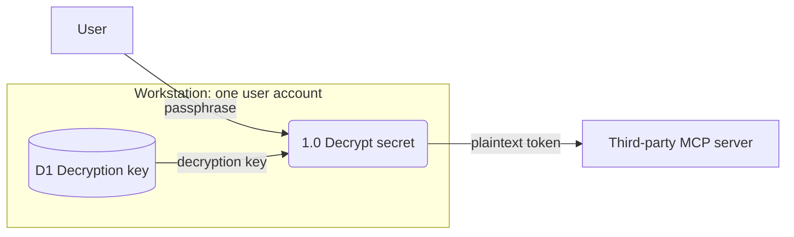

# DFD

References:

- <https://miro.com/diagramming/what-is-a-data-flow-diagram/> — components, levels, logical vs physical.
- <https://www.visual-paradigm.com/guide/data-flow-diagram/what-is-data-flow-diagram/> — drawing rules, balancing.

A DFD shows where data moves and what transforms it. Order and failure
belong in sequence diagrams, object structure in UML; a DFD carries
neither. Control signals are not data: list them in prose under the
diagram they would otherwise clutter.

## Components

Four, and only four:

| Component | Is | Gane–Sarson | Yourdon/DeMarco | Mermaid |
| --- | --- | --- | --- | --- |
| External entity | A source or sink outside the system boundary | square | rectangle | `E[Name]` |
| Process | Work that transforms input data into output data | rounded rectangle | circle | `P(1.0 Verb the thing)` |
| Data store | Data at rest — a file, table, queue, keyring | open-ended rectangle | two parallel lines | `S[(D1 Name)]` |
| Data flow | Named data moving between the above | labelled arrow | labelled arrow | `A -->\|data name\| B` |

Name every element. Entities and stores take noun phrases, processes
take verb phrases, flows take the name of the data itself
(`plaintext token`), never the mechanism carrying it. Number stores
`D1`, `D2` in order of first appearance and keep each number at every
level. Give every node a semantic Mermaid id (`apply`, `tokens`) so the
edge list reads without the declarations.

## Levels

Each level decomposes one process from the level above.

- **Context** — the whole system as a single process numbered `0`,
  surrounded by every external entity it exchanges data with, each flow
  named as Level 0 names it. No data stores; internal storage is inside
  the system.
- **Level 0** — process `0` opened up into its major processes,
  numbered `1.0`, `2.0`, `3.0`. Data stores appear here first. A
  sentence above the diagram counts its processes and stores, then a
  list names each trust boundary and who controls it.
- **Level 1 onward** — one process from the level above opened up,
  numbered beneath it. Decomposing `2.0` gives `2.1`, `2.2`;
  decomposing `2.1` gives `2.1.1`.

Stop at the level that answers the question asked, or at a process
whose decomposition would only restate it.

Pick logical or physical per diagram and hold it: a logical DFD names
business activities, a physical one names the software, hosts, and
files doing the work.

## Rules

Drawing:

- Every process consumes and produces, and its inputs account for its
  outputs. Input with no output is a *black hole*, output with no input
  a *miracle*, output the inputs can't account for a *grey hole*. Each
  is a missing flow or a wrong boundary.
- Data flows through a process. Store-to-store, entity-to-entity, and
  entity-to-store flows all need a process between them, because
  stores and entities are passive.
- Every flow has a labelled direction. A bidirectional arrow is two
  flows carrying two different pieces of data; draw both.

Balancing:

- Level 0 names the same external entities the context diagram names,
  and its flows to them balance against process `0`'s.
- A child diagram's inflows and outflows match its parent process's
  exactly — same set, same names.
- Only boundary-crossing flows balance; flows internal to the
  decomposition are new at the child level. A store the parent diagram
  draws sits outside the decomposition; one first drawn in the child is
  internal to it.
- Renaming a flow at one level renames it at every level it appears.

Scope:

- State what holds with no adversary: data at rest is plaintext or
  encrypted, a flow carries a named credential, a process runs
  unattended, one entity is the only inbound path. "No flow connects
  the token store to the signing key" is a DFD fact; "so a stolen token
  can't sign a commit" is the threat model's conclusion, which it
  checks itself. Blast radius, attribution, and mitigations go there
  too.
- Link each defect the drawing exposes to its filed issue.
- Name a credential store by what it holds, without its path on disk.

Currency:

- The diagram matches the system. Update it in the same change that
  adds, removes, or retunes an element it shows.

## Output

Mermaid `flowchart`, fenced inline in the markdown document. Renders on
GitHub with no export step and no tool to install. Classic node shapes
only — the `A@{ shape: ... }` extended syntax needs a Mermaid version
the renderer may not have.

Trust boundaries are an overlay, not a fifth component. Draw them on
DFDs for security work, where crossing one is the finding: one
`subgraph` per boundary, labelled `Name: who controls it`. Nest a
subgraph for a boundary inside the system, such as an app that holds its
own store and gates what it releases.

Under Level 0, tabulate each store: what it holds and whether it is
encrypted at rest.

## Location

A DFD of the system as it stands is a Diátaxis reference, at
`docs/reference/data-flow.md`. A DFD arguing for a design sits beside
its argument, in an explanation or a decision record. The `diataxis`
skill owns the mode test and the surrounding prose.

Keep every level of one system's DFD in one file, each level under its
own heading and separated by a rule, so balancing is checkable in a
single read. The page opens with one sentence of scope, then an
out-of-scope list, then links to its companions.

Answer each further question on its own reference page beside it,
`data-flow-<topic>.md`, linking back to the level it extends:

- Order and failure along a path: one sequence diagram per path.
- Lookups across the diagram, such as each credential's source, holder,
  and reach: a table.
- The representation data takes at each hop, and every rule applied in
  more than one layer.

Reasons stay out of all of them; link the explanation that carries them.

## Procedure

Draw:

1. Fix the system boundary — what is inside, which external entities
   exchange data with it, and, for security work, which trust
   boundaries the data crosses. Write the scope and out-of-scope list.
2. List what each process consumes and produces before drawing its
   flows. A process whose two lists you can't complete is the wrong
   process, or sits on the wrong side of the boundary.
3. Decompose to Level 0, then further only where the question needs
   it, repeating step 2 at each level.
4. Name every element and every flow, then draw the context diagram
   from Level 0's boundary flows.

Check:

1. Walk *Rules* against the result, drawing rules first.
2. Balance each child diagram against its parent's flow set, and
   Level 0 against the context diagram.
